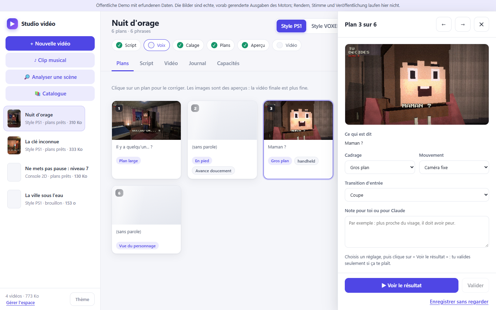

# Horror Studio 3D – prozedurale Erzählwelten

Ein lokales Studio verbindet Szenenbeschreibung, Figuren, Kamera, zwei Bildrichtungen, Ton und Qualitätsprüfung. Das öffentliche Repository enthält den Motor und synthetische Beispiele, keine privaten Geschichten oder Stimmen.

**Technik:** Python, NumPy, Pillow, Three.js, FFmpeg.

[Interaktive Demo](https://jorxas.github.io/HorrorStudio3D/) · [Portfolio](https://jorxas.github.io/Portfolio/) · [Architektur](ARCHITEKTUR.md) · [Prüfstatus](PRUEFUNG.md)

## Ausprobieren

Die Demo ist die echte Oberfläche des Studios (`hstudio/web/static/studio.html` mit `studio_extras.js`), keine Nachbildung. Sie öffnet vier erfundene Beispielprojekte: drei aus den Szenarien unter `examples/demos` mit ihren echten Plänen und Zeiten und einen Entwurf ohne Pläne. Plan korrigieren, Szene analysieren und Katalog durchsuchen funktionieren; Änderungen gelten nur bis zum Neuladen.

Was die Demo nicht tut: Der Python-Motor läuft nicht im Browser. Die Plan-Bilder sind die zwölf echten, vorab gerenderten Motorbilder aus `demo/bilder` (Zuordnung in `demo/daten/projekte.json`), der Szenenplaner antwortet für den Entwurf, die Beispieltexte und die Projektskripte mit vorab berechneten echten Ergebnissen, der Katalog zeigt eine Auswahl mit vom Motor gemalten Miniaturen (PS1 und Console 2D; VOXEL braucht die GPU). Rendern, Stimme, Musikanalyse, freie Szenenanalyse und Veröffentlichung sind nicht verfügbar und sagen das, statt ein Ergebnis zu erfinden.

## Demo bauen und prüfen

~~~sh
node tools/demo-bauen.mjs                   # schreibt dist/
npm install --no-save puppeteer-core        # einmalig, für die Browserprüfung
node tools/demo-pruefen.cjs                 # Chrome oder Edge, optional --bild=docs/vorschau.png
python -m http.server 8080 --bind 127.0.0.1 --directory dist
~~~

Danach http://127.0.0.1:8080 öffnen. Die Demo benötigt weder Konten noch Modellgewichte. Die Daten unter `demo/daten`, `demo/vorschau` und `demo/katalog` erzeugt `python tools/demo_export.py` aus dem echten Motor; der Server `python -m hstudio web` liefert dieselbe Oberfläche mit dem vollen Funktionsumfang.

## Lokal prüfen

~~~sh
python -m pip install -r requirements.txt
python -m hstudio --help
~~~

Die genauen geprüften Befehle und Grenzen stehen in [PRUEFUNG.md](PRUEFUNG.md). Produktive Schlüssel, persönliche Daten und Modelle gehören ausschließlich in die lokale Installation.

## Herkunft

Dies ist eine für die Veröffentlichung geprüfte Ableitung eines bestehenden lokalen Projekts. [HERKUNFT.md](HERKUNFT.md) trennt den ursprünglichen Entwicklungsstand von den jetzt ausgeführten Veröffentlichungsarbeiten. Die ursprünglichen Oberflächen und technischen Bezeichner sind teilweise französisch oder englisch. Neue Präsentation und Dokumentation sind deutsch.

## Rechte und Abhängigkeiten

Für eigenen Quellcode wird hier keine zusätzliche Nutzungslizenz eingeräumt. Die Lizenzen der genannten Bibliotheken und Modelle gelten unabhängig davon. Fremde Modelle, Stimmen, Medien und Zugangsdaten werden nicht mitgeliefert. Siehe [DRITTANBIETER.md](DRITTANBIETER.md).

## Beispiele und Bilder

`python tools/check_v3.py` prüft Planer, Erweiterungen und Bildlogik. `python demo/bilder_erstellen.py` erzeugt zwölf stille Demobilder ohne Sprachdienst. Die Schriften unter `assets/fonts/` stehen unter ihren mitgelieferten SIL-OFL-Lizenzen.

## Lokaler Studiomotor

Nach Installation der Python-Abhängigkeiten zeigt `python -m hstudio --help` die vorhandenen Werkzeuge. `python -m hstudio web --port 8767 --no-browser` startet die lokale Oberfläche; diese Veröffentlichung richtet keine Sprach- oder Veröffentlichungskonten ein. Für reines Betrachten genügt die statische Demo (siehe oben). Der GPU-Pfad besitzt zusätzliche Node-Abhängigkeiten unter `voxelgpu_js/`; die dokumentierte Abnahme umfasst den Python-Motor.
